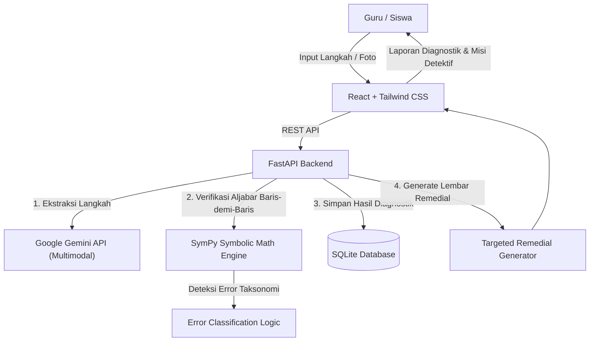

# Jejak Nalar 🧮
> **Neuro-Symbolic Diagnostic & Adaptive Remedial Engine for Mathematics**  
> *Solusi Asesmen Diagnostik dan Pembelajaran Berdiferensiasi Cerdas untuk Guru Matematika Indonesia*

[](https://logicodix.com)
[]()
[]()
[](LICENSE)

---

## 📌 Identitas Tim & Proyek

* **Nama Tim:** *(Akan diperbarui sesuai registrasi resmi)*
* **Institusi:** *(Nama Sekolah / Asal Tim)*
* **Anggota Tim:**
  1. Ketua Tim / Developer: `@riberii`
  2. Anggota Tim: *Nicho@Jellyboom666*
  3. Anggota Tim: *Owen*
  4. Anggota Tim: *Orlando*
* **Kategori Kompetisi:** Web Application
* **Subtema:** Smart & Fun Education

---

## 💡 Permasalahan (Problem Statement)

Dalam implementasi Kurikulum Merdeka di Indonesia, guru matematika SMP diwajibkan menyelenggarakan **asesmen diagnostik** dan **pembelajaran remedial berdiferensiasi**. 

Namun di lapangan, guru menghadapi kendala operasional yang berat:
1. **Analisis Manual Memakan Waktu:** Memeriksa lembar jawaban uraian 30–120 siswa satu per satu membuat guru hanya sempat memberikan nilai angka akhir, tanpa sempat mengelompokkan pola kesalahan (*misconception pattern*).
2. **Remedial Tidak Tepat Sasaran:** Siswa yang salah karena lupa rumus disatukan dalam sesi remedial yang sama dengan siswa yang salah konsep aljabar mendasar (misal: kesalahan tanda saat pemindahan ruas).
3. **Limitasi LLM Murni:** Guru tidak dapat mengandalkan ChatGPT/Gemini secara langsung untuk memeriksa matematika karena LLM rentan berhalusinasi (*hallucination*) pada konsistensi kalkulasi simbolik langkah demi langkah.

---

## 🚀 Solusi: Jejak Nalar

**Jejak Nalar** hadir sebagai platform web cerdas berbasis arsitektur **Neuro-Symbolic**:
* **AI (Vision & Text LLM):** Berperan mengekstrak tulisan langkah pengerjaan siswa yang bebas/tidak terstruktur menjadi teks ekspresi matematika.
* **Deterministic Engine (SymPy):** Memverifikasi keabsahan aljabar dari baris ke baris secara mutlak matematis, mendeteksi di langkah ke berapa kesalahan pertama terjadi, dan melabeli jenis miskonsepsinya.
* **Human-in-the-Loop:** Guru memiliki kendali penuh 1-klik untuk mengonfirmasi hasil bacaan sebelum analisis dikunci.
* **Misi Detektif Nalar (Fun Remedial):** Sistem secara otomatis menghasilkan materi remedial interaktif bertema gamifikasi "Detektif Kesalahan", di mana siswa dilatih menemukan letak kekeliruan aljabar pada studi kasus fiktif.

---

## 🏗️ Arsitektur Sistem & Alur Data



---

## ✨ Fitur Utama (MVP Roadmap)

- [ ] **Dual-Input Mode:** Input langkah matematika pengerjaan siswa via *Quick Step Text* atau *Photo Upload*.
- [ ] **Deterministic Step Verifier:** Pemeriksaan kesetaraan aljabar persamaan linear satu variabel (PLSV) menggunakan SymPy.
- [ ] **Automated Misconception Taxonomy:** Pelabelan otomatis jenis kesalahan (Kesalahan Tanda Pindah Ruas, Kesalahan Operasi Distributif, Kesalahan Aritmatika Dasar).
- [ ] **Teacher Verification Preview (Split Screen):** Guru dapat mengoreksi hasil pembacaan teks sebelum diproses lebih lanjut.
- [ ] **Classroom Misconception Dashboard:** Ringkasan visual sebaran kesalahan sekelas dalam bentuk diagram batang interaktif.
- [ ] **Misi Detektif Nalar:** Lembar tugas remedial adaptif yang dirancang spesifik untuk kelompok siswa berdasarkan jenis miskonsepsi mereka.

---

## 🛠️ Teknologi & Pustaka

| Komponen | Teknologi | Keterangan |
|---|---|---|
| **Frontend** | React 18, Vite, Tailwind CSS, Lucide Icons | Antarmuka cepat, modern, dan mobile-responsive |
| **Backend** | Python 3.11/3.14, FastAPI, Uvicorn | Backend asinkron berkecepatan tinggi dengan auto-Swagger docs |
| **Math Engine** | SymPy | Pustaka matematika simbolik Python (100% deterministik) |
| **Database** | SQLite, SQLAlchemy | Database relasional ringan dan portable untuk localhost demo |
| **AI Integration** | Google Gemini API (`gemini-1.5-flash` / `gemini-2.0-flash`) | Ekstraksi multimodal dan narasi remedial terstruktur |
| **Validation** | Pydantic v2 | Validasi skema input/output data ketat |

---

## ⚙️ Panduan Instalasi & Menjalankan Proyek

### Prasyarat
* Python 3.10+ (Direkomendasikan Python 3.11 atau 3.12/3.14)
* Node.js v18+ atau v20+
* Git

### 1. Clone Repositori
```bash
git clone https://github.com/riberii/jejak-nalar.git
cd jejak-nalar
```

### 2. Konfigurasi Environment Variable
Salin file `.env.example` menjadi `.env`:
```bash
copy .env.example .env
```
Buka file `.env` dan masukkan API Key Google Gemini kalian.

### 3. Menjalankan Backend (FastAPI)
```bash
cd backend
python -m venv venv
# Windows:
.\venv\Scripts\activate
# Install dependensi:
pip install -r requirements.txt
# Jalankan server backend:
uvicorn main:app --reload --port 8000
```
Dokumentasi API interaktif dapat diakses di: `http://localhost:8000/docs`

### 4. Menjalankan Frontend (React)
Buka terminal baru di folder utama proyek:
```bash
cd frontend
npm install
npm run dev
```
Aplikasi web dapat diakses di: `http://localhost:5173`

---

## 🔑 Akun Demonstrasi (Demo Accounts)

Untuk mempermudah dewan juri dalam melakukan pengujian, aplikasi ini menyediakan mode akses demo instan tanpa perlu registrasi:
* **Peran Guru:** Akses langsung via tombol *"Masuk Sebagai Guru Demo"* di halaman utama.
* **Peran Siswa:** Masukkan Kode Sesi Demo: `NALAR-2026`.

---

## 🤖 Dokumentasi Penggunaan AI

Sesuai dengan ketentuan resmi LOGICODIX 2026, penggunaan AI dalam produk ini didokumentasikan secara transparan:
1. **Model yang Digunakan:** Google Gemini API (`gemini-1.5-flash` / `gemini-2.0-flash`).
2. **Bagian yang Menggunakan AI:**
   * Ekstraksi tulisan bebas/foto lembar jawaban menjadi teks baris-demi-baris terstruktur JSON.
   * Pembuatan narasi kontekstual untuk lembar latihan "Detektif Kesalahan".
3. **Bagian yang TIDAK Menggunakan AI:**
   * Pemeriksaan benar/salah dari langkah matematika dihitung **100% menggunakan kode aljabar simbolik SymPy**.
   * Penentuan kelompok remedial dan kalkulasi statistik dihitung oleh logika sistem backend.

---

## 📜 Atribusi Sumber Daya Pihak Ketiga

* **SymPy:** Computer Algebra System in Python ([sympy.org](https://www.sympy.org/)) - New BSD License.
* **FastAPI:** Modern, fast web framework for building APIs with Python ([fastapi.tiangolo.com](https://fastapi.tiangolo.com/)) - MIT License.
* **Tailwind CSS:** Utility-first CSS framework ([tailwindcss.com](https://tailwindcss.com/)) - MIT License.
* **Lucide Icons:** Clean and consistent iconography ([lucide.dev](https://lucide.dev/)) - ISC License.

---
*Dibuat untuk LOGICODIX 2026 Hackathon Competition — Subtema Smart & Fun Education.*
